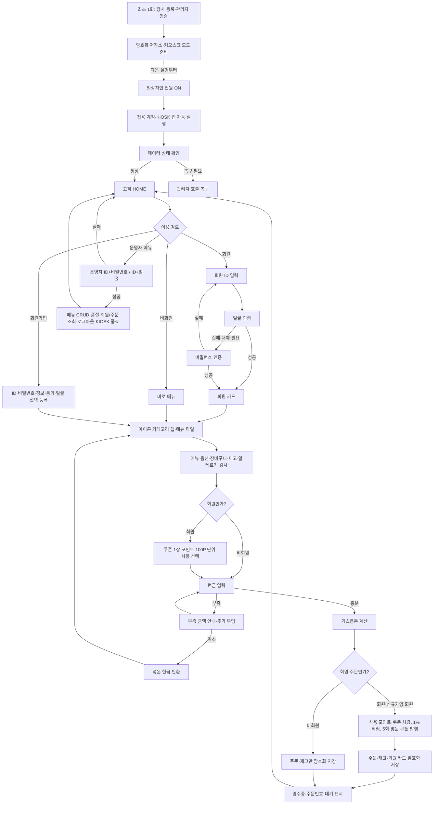

# 10월 21일 회의용 KIOSK 최종 BASE 흐름도

이 문서의 목적은 **누가 무엇을 누르면 다음에 무엇이 보이고, 회원과 비회원의 데이터 처리가
어디에서 달라지는지**를 팀원 전원이 같은 그림으로 이해하는 것이다. 화면 디자인은 별도의
Figma 통합 와이어프레임을 기준으로 한다.

## BASE 흐름도

### 회원·비회원 처리 원칙

- 회원, 비회원 모두 같은 메뉴·옵션·장바구니·재고·알레르기 검사와 현금 결제를 사용한다.
- 거스름돈 계산, 주문 저장, 재고 차감, 영수증과 주문번호 발급은 공통이다.
- 포인트·쿠폰 계산과 회원 카드 갱신은 회원 및 가입 직후 회원에게만 실행한다.
- 대기 화면은 회원에게 `닉네임·칭호 + 주문번호`, 비회원에게 `비회원 + 주문번호`를 표시한다.
- 코드에서는 이용 경로에서 정한 `is_member` 값을 결제 완료까지 유지하고, 회원 전용 처리만
  조건문으로 실행한다. 비회원용 주문 프로그램을 별도로 만들지 않는다.

## Figma에서 확인할 핵심 화면 6장

새로 종이에 그리지 않고 Figma AI 통합 와이어프레임에서 아래 요소와 연결을 확인한다.

1. `HOME`: 회원 주문 / 비회원 주문 / 회원가입 / 운영자 메뉴 (KIOSK 종료는 운영자 화면에만 있음)
2. `회원 인증·카드`: ID / 얼굴 시도 / 비밀번호 폴백 / 닉네임·포인트
3. `메뉴`: 아이콘 카테고리 탭 / 메뉴 타일 / 장바구니 / 알레르기 경고
4. `현금 결제`: 총액 / 투입 현금 / 부족 금액 또는 거스름돈 / 다시 입력
5. `완료`: 주문번호 / 회원 닉네임 또는 비회원 표시 / 영수증 / 회원일 때만 포인트·쿠폰
6. `운영자`: 로그인(09-A) / 메뉴 추가·수정·삭제·품절(09-B) / 마스킹된 회원·주문 조회(09-C)

## 팀원이 와이어프레임에서 확인할 것

- 이 화면에 들어오는 조건
- 사용자가 누를 수 있는 것
- 다음 화면
- 정상 흐름 1개
- 실패 흐름 1개
- 간판 아이디어가 들어갈 자리 1개

## 첫 회의 권장 순서

1. KIOSK 확정과 오늘 반드시 결정할 내용을 5분 안에 공유한다.
2. 팀원 아이디어를 평가하지 않고 먼저 모두 설명받는다.
3. BASE 실행을 보여 주며 이미 되는 것과 아이디어가 들어갈 빈자리를 설명한다.
4. 간판 기능 1개, 보조 기능 최대 2개를 선정 기준으로 고른다.
5. 위 최종 흐름도에서 아이디어와 실패 상황이 들어갈 위치를 확인한다.
6. Figma 통합 와이어프레임에서 핵심 화면 6장과 버튼 연결을 확인한다.
7. 실제 필요한 화면 수를 본 뒤 TUI/Textual 유지 또는 GUI 전환을 결정한다.
8. GUI를 고르면 현재 Figma 와이어프레임에 외부 템플릿의 공통 스타일만 참고한다.
9. `화면 / 계산 / 카메라 / 데이터·테스트 / 통합` 중 맡고 싶은 영역을 듣고 역할을 정한다.

## 회의에서 받을 팀원별 등록 선택

- 시연용 회원 ID와 닉네임
- 실명 표시 동의 여부
- 얼굴 촬영·등록 동의 여부
- 얼굴 자료를 수업용 PC 로컬에만 보관한다는 동의
- 시연 프로필과 보여 주고 싶은 기능
- 얼굴 등록을 원하지 않을 때 비밀번호만 사용할 것인지

비밀번호 자체는 회의록에 적거나 서로 공유하지 않고 각자 직접 입력한다.

Figma 결과는 구현용 설계도와 발표 자료로 함께 사용한다. 단, 템플릿의 화려한 화면을
많이 만드는 것보다 실제 프로그램에 연결할 핵심 화면 6개를 일관되게 만드는 것을 우선한다.

아이디어 선정 기준은 `30초 안에 시연되는가`, `회원 데이터 카드를 실제로 사용하는가`,
`기본 결제를 깨뜨리지 않는가`, `10월 28일까지 연결 가능한가` 네 가지면 충분하다.
