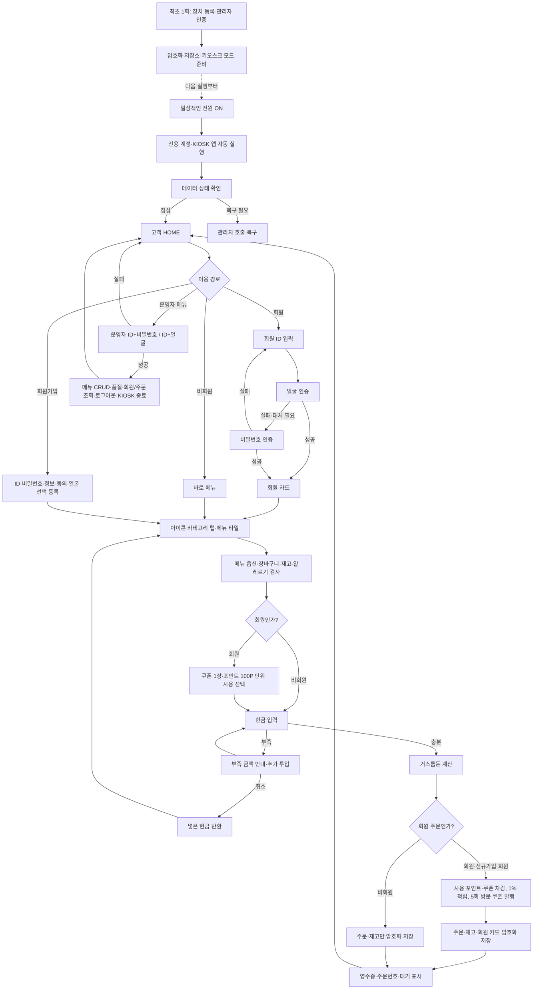
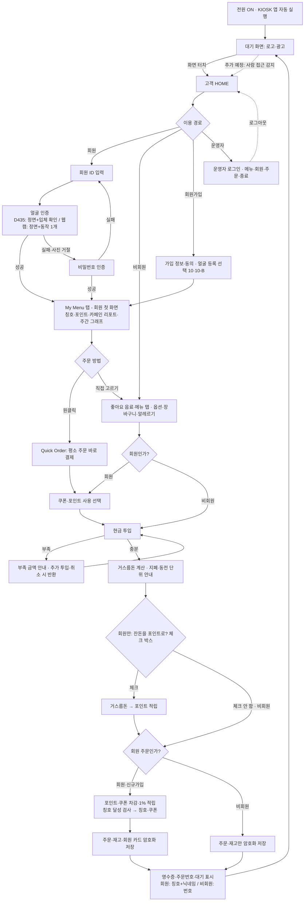
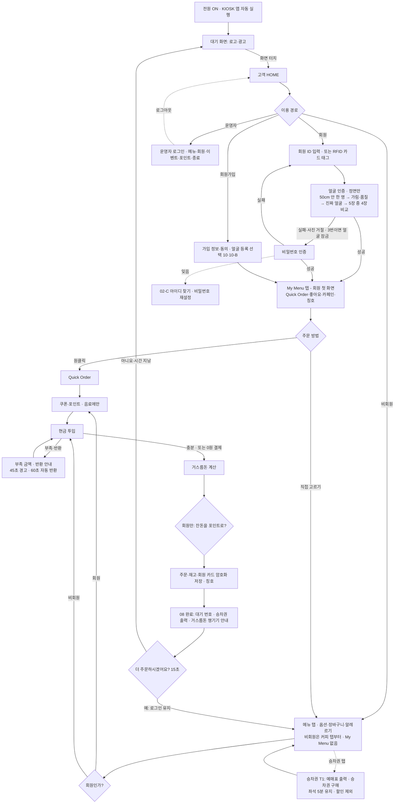

# 10월 21일 회의용 KIOSK 최종 BASE 흐름도

이 문서의 목적은 **누가 무엇을 누르면 다음에 무엇이 보이고, 회원과 비회원의 데이터 처리가
어디에서 달라지는지**를 팀원 전원이 같은 그림으로 이해하는 것이다. 화면 디자인은 별도의
Figma 통합 와이어프레임을 기준으로 한다.

## BASE 흐름도

### 회원·비회원 처리 원칙

- 회원, 비회원 모두 같은 메뉴·옵션·장바구니·재고·알레르기 검사와 현금 결제를 사용한다.
- 거스름돈 계산, 주문 저장, 재고 차감, 영수증과 주문번호 발급은 공통이다.
- 포인트·쿠폰 계산과 회원 카드 갱신은 회원 및 가입 직후 회원에게만 실행한다.
- 대기 화면은 회원에게 `닉네임·칭호 + 주문번호`, 비회원에게 `비회원 + 주문번호`를 표시한다.
- 코드에서는 이용 경로에서 정한 `is_member` 값을 결제 완료까지 유지하고, 회원 전용 처리만
  조건문으로 실행한다. 비회원용 주문 프로그램을 별도로 만들지 않는다.

## Figma에서 확인할 핵심 화면 6장

새로 종이에 그리지 않고 Figma AI 통합 와이어프레임에서 아래 요소와 연결을 확인한다.

1. `HOME`: 회원 주문 / 비회원 주문 / 회원가입 / 운영자 메뉴 (KIOSK 종료는 운영자 화면에만 있음)
2. `회원 인증·카드`: ID / 얼굴 시도 / 비밀번호 폴백 / 닉네임·포인트
3. `메뉴`: 아이콘 카테고리 탭 / 메뉴 타일 / 장바구니 / 알레르기 경고
4. `현금 결제`: 총액 / 투입 현금 / 부족 금액 또는 거스름돈 / 다시 입력
5. `완료`: 주문번호 / 회원 닉네임 또는 비회원 표시 / 영수증 / 회원일 때만 포인트·쿠폰
6. `운영자`: 로그인(09-A) / 메뉴 추가·수정·삭제·품절(09-B) / 마스킹된 회원·주문 조회(09-C)

## 팀원이 와이어프레임에서 확인할 것

- 이 화면에 들어오는 조건
- 사용자가 누를 수 있는 것
- 다음 화면
- 정상 흐름 1개
- 실패 흐름 1개
- 간판 아이디어가 들어갈 자리 1개

## 첫 회의 권장 순서

1. KIOSK 확정과 오늘 반드시 결정할 내용을 5분 안에 공유한다.
2. 팀원 아이디어를 평가하지 않고 먼저 모두 설명받는다.
3. BASE 실행을 보여 주며 이미 되는 것과 아이디어가 들어갈 빈자리를 설명한다.
4. 간판 기능 1개, 보조 기능 최대 2개를 선정 기준으로 고른다.
5. 위 최종 흐름도에서 아이디어와 실패 상황이 들어갈 위치를 확인한다.
6. Figma 통합 와이어프레임에서 핵심 화면 6장과 버튼 연결을 확인한다.
7. 실제 필요한 화면 수를 본 뒤 TUI/Textual 유지 또는 GUI 전환을 결정한다.
8. GUI를 고르면 현재 Figma 와이어프레임에 외부 템플릿의 공통 스타일만 참고한다.
9. `화면 / 계산 / 카메라 / 데이터·테스트 / 통합` 중 맡고 싶은 영역을 듣고 역할을 정한다.

## 회의에서 받을 팀원별 등록 선택

- 시연용 회원 ID와 닉네임
- 실명 표시 동의 여부
- 얼굴 촬영·등록 동의 여부
- 얼굴 자료를 수업용 PC 로컬에만 보관한다는 동의
- 시연 프로필과 보여 주고 싶은 기능
- 얼굴 등록을 원하지 않을 때 비밀번호만 사용할 것인지

비밀번호 자체는 회의록에 적거나 서로 공유하지 않고 각자 직접 입력한다.

Figma 결과는 구현용 설계도와 발표 자료로 함께 사용한다. 단, 템플릿의 화려한 화면을
많이 만드는 것보다 실제 프로그램에 연결할 핵심 화면 6개를 일관되게 만드는 것을 우선한다.

아이디어 선정 기준은 `30초 안에 시연되는가`, `회원 데이터 카드를 실제로 사용하는가`,
`기본 결제를 깨뜨리지 않는가`, `10월 28일까지 연결 가능한가` 네 가지면 충분하다.

---

# v2 흐름도 — GUI · 채택 아이디어 반영 (2026-10-22)

그림: 바탕화면 `AI프로젝트/1028회의예정/01_플로차트_v2/04_KIOSK_v2_플로차트.png` (그리는 스크립트 `draw_flowchart_v2.py`도 같은 폴더). 위 BASE 흐름도는 기록용으로 남긴다.
반영: 핵심 My Menu 탭(Quick Order·좋아요·카페인 리포트), 서브 A1 칭호, 서브 C1 잔돈 포인트(회원만),
D435 입체 얼굴 인증, 대기 화면. 사람 접근 감지(D10)는 점선으로 표시한 추가 예정 기능이다.

### v2에서 달라진 점

- 회원은 로그인 후 **My Menu 탭이 먼저** 열린다. 비회원에게는 My Menu가 없고 커피 탭부터 시작한다.
- Quick Order는 장바구니를 건너뛰고 쿠폰·포인트 선택 → 현금 결제로 바로 간다.
- 카페인 리포트는 주문 기록과 메뉴별 `caffeine_mg`로 계산한다(디카페인은 0).
- 거스름돈이 나온 뒤 "잔돈을 포인트로" 체크 박스는 **회원에게만** 보인다. 체크하면 거스름돈을 포인트로 적립한다. 비회원은 현금 거스름돈만 받는다.
- 회원 결제 뒤 칭호 달성 검사를 하고, 칭호는 My Menu·영수증·대기 표시에 나온다.
- 주문 대결(D1)은 프로토타입 완성 뒤 여유가 있을 때 추가하므로 이 흐름도에는 넣지 않았다.

---

# v4 흐름도 — 실제 프로그램 기준 (2026-10-31)

그림: `최신본_2026-10-19/01_회의_및_계획/다음회의_예정/09_발표준비/01_KIOSK_v4_전체_플로차트.png`
(그리는 스크립트 `draw_flowchart_v4.py` 같은 폴더). 승차권 탭 안쪽은 `02_승차권탭_상세_플로차트.png`.
v2에서 바뀐 것: RFID 카드 · 정면만 보는 얼굴 인증(가림·품질 → 진짜 얼굴 → 5장 비교, 3번 실패 잠금) ·
02-C 아이디·비밀번호 찾기 · 승차권 탭 · 현금 45초 경고/60초 반환 · 08 '더 주문하시겠어요?(15초)'.

## 와이어프레임(Figma v2.1, 10/23)과 실제 화면이 다른 점 — 결정된 변경

Figma 통합 와이어프레임은 10/23 v2.1에서 멈춰 있다. 아래는 그 뒤 회의·검토에서 정해서 실제 화면에 반영한 것이다.
Figma를 고칠 때 이 표를 기준으로 한다.

| 화면 | 와이어프레임 v2.1 | 실제 프로그램 | 결정 |
|---|---|---|---|
| 03 메뉴 | 위쪽 가로 탭(My Menu · 커피 · …) | **왼쪽 세로 카테고리 줄** + 선 아이콘 | 10/28 디자인 템플릿 |
| 03 메뉴 | 탭 6개 | 회원 8칸: **My Menu → 승차권 → 커피 …** / 비회원 7칸: **승차권 → 커피 …** (My Menu는 회원 전용) | 10/28 승차권 채택, T1-0 와이어프레임 |
| 03 메뉴 카드 | 이미지 자리 | 실제 메뉴 사진 50장 · 코랄 `+` | 10/29 |
| 04 옵션 | 한 칸 팝업 | 왼쪽 큰 잔 · 오른쪽 둥근 칩 · 코랄 담기 버튼 | 10/28 디자인 템플릿 |
| 02 로그인 | 카메라 미리보기 · 동작 안내 | 화면 안 얼굴 기호 · 할 일 한 줄 · 회원가입 링크 · 카드 연결 · 찾기 | 10/29 검토 |
| 02-C | 없음 | 아이디 찾기 · 비밀번호 재설정 | 10/28 회의 6번 |
| 10-B 얼굴 등록 | 카메라 + 타원 | 얼굴 기호, 50cm 안이면 진행 | 10/29 검토 |
| 07 현금 | 상태 한 줄 | '방금 일' 줄 + '지금 상태' 줄 · 남은 금액 · 0원 결제 | 10/29 결제 점검 |
| 08 완료 | '처음 화면으로' | 주문 현황 줄 · 거스름돈·승차권 챙기기 · **더 주문하시겠어요?(15초)** | 10/29 |
